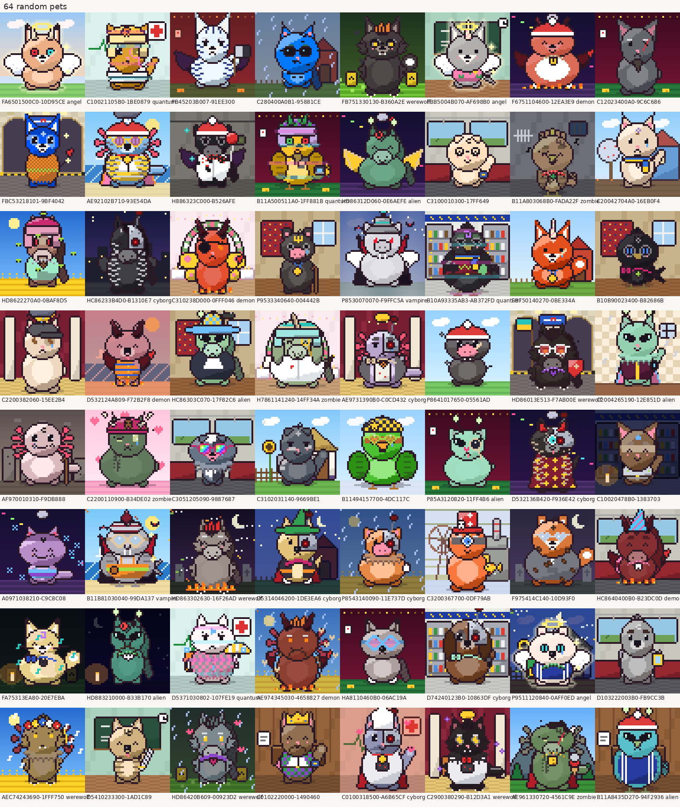
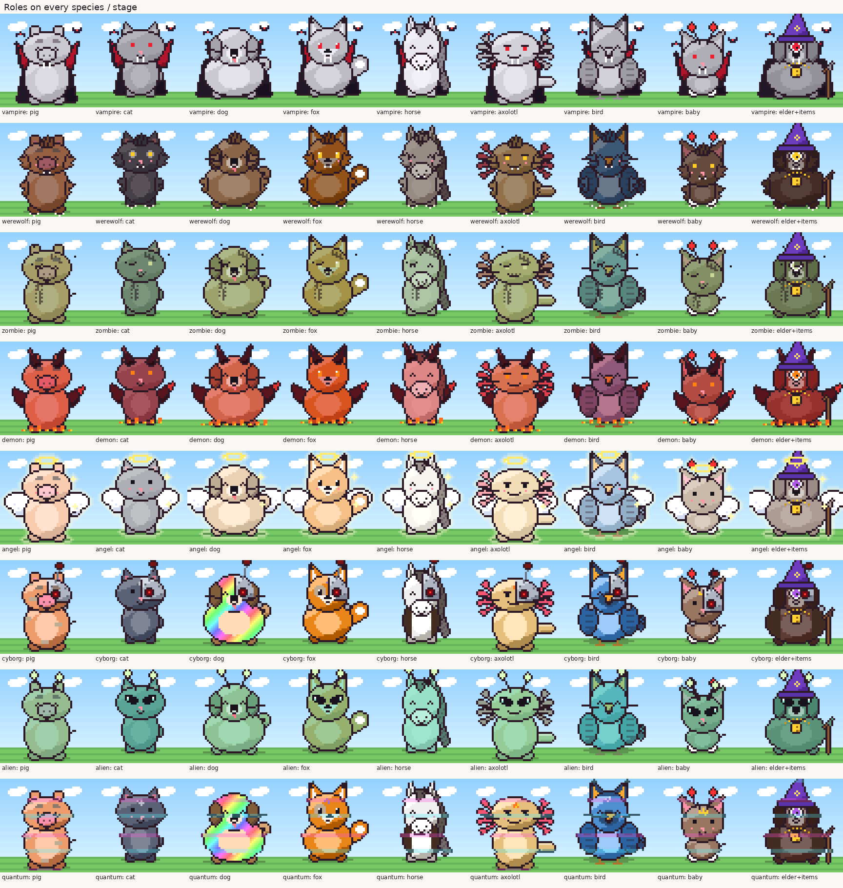
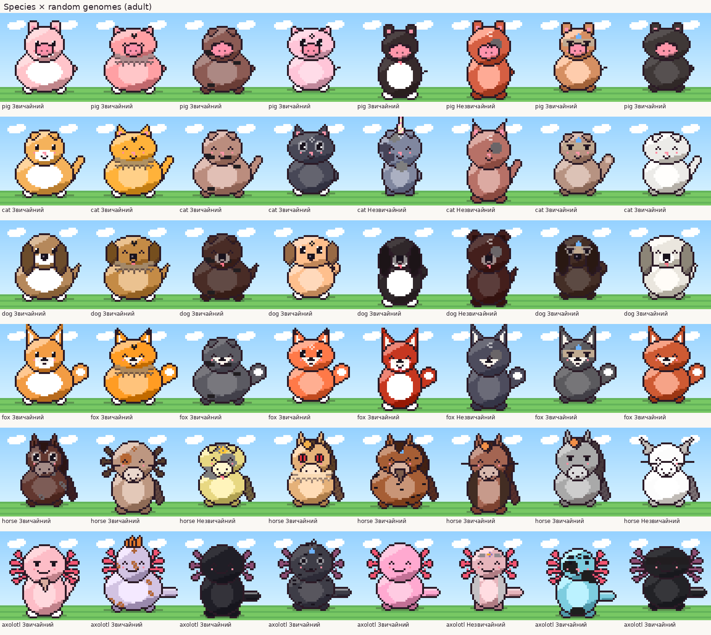

# 🐾 Тамагочі: життя пета

Велика гра всередині бота. **У кожного учасника в кожному чаті свій унікальний пет**, і в нього справжнє життя:
народження, школа, робота, кохання, діти, вампіризм, тюрма, старість, смерть і спадкоємці.
Майже все в цьому житті вирішують рішення власника, характер пета, стосунки з петами інших учасників і трохи хаосу.



## Швидкий старт

1. `/pet` → обираєш вид: 🐷 порося · 🐱 кошеня · 🐶 цуценя · 🦊 лисеня · 🐴 лоша · 🦎 аксолотль.
2. Знесене яйце вилуплюється приблизно за годину. Характер, мрія, страх, дивна звичка й улюблена їжа випадають випадково.
3. Картка пета: анімований GIF + кнопки. Годуй, грай, мий, лікуй, тисни **🎲 Пригода** і приймай рішення.
4. Час від часу бот сам кидає у чат **пригоду** твого пета з варіантами. Обираєш ти, а решта чату підказує й робить ставки.

## Команди

| Команда | Що робить |
|---|---|
| `/pet` (реплаєм — чужий пет) | картка пета з кнопками догляду, пригод, гардеробу, базару, дому й роботи; в особистих — меню «Твої пети» |
| `/pet_name Ім'я` | перейменувати (до 24 символів) |
| `/pet_story` | журнал життя |
| `/pet_bio` | біографія від Gemini у стилі «ЖЗЛ» (без ШІ — журнал) |
| `/pet_date` · `/pet_fight` (реплаєм) | запросити пета іншої людини на побачення або бійку; та людина має підтвердити |
| `/zoo` | груповий портрет петів чату (по 12, з підписами) |
| `/pet_top` | топ за рівнем, грошима, віком, рідкістю |
| `/dna` | гени, ДНК-код і рідкість |
| `/family` | династія: предки, спадкоємці |
| `/graveyard` | кладовище з епітафіями |
| `/bazar` | базар дня: речі (зокрема згенеровані) і будинки |
| `/pet_help` | коротка довідка в чаті |

Текстові тригери: «пет», «мій пет».

## 💬 Гра в особистих з ботом

Напиши боту в особисті `/start` або `/pet`, і він відкриє меню «Твої пети»:

- **🏠 Особистий пет** живе лише в особистих. Він росте, працює, проходить пригоди й помирає так само, як груповий,
  але все бачиш тільки ти. Світові події й вечірня хроніка теж приходять сюди. Соціальних зустрічей нема: поруч нема інших петів.
- **👥 Пульт для групових петів.** Обираєш пета з будь-якої групи і доглядаєш його звідси: годуєш, граєш, відправляєш у пригоди,
  міняєш гардероб, купуєш на базарі, змінюєш дім і роботу. Ти позначаєшся як активний у тій групі, тож пет не переходить у «тихе життя».
- **📬 Пригоди в особисті** (кнопка на картці): одиночні пригоди групового пета приходять тобі в особисті, а не в чат.
  Це тихіше для великих чатів. Зустрічі з петами інших людей, світові події, поради й ставки чату лишаються в групі.
  Щоб увімкнути це з групи, спершу відкрий боту особисті (Telegram не дає ботам писати першими).
  Якщо бот не може тобі написати, пригода повертається в групу.
- Кнопки в особистих пам'ятають, до якого чату належить пет, тож старі картки не переплутаються після перемикання.
  Керувати так можна лише **своїм** петом: чужа або підроблена кнопка не спрацює.
- `/pet_date` і `/pet_fight` працюють лише в групі, де живуть обидва пети.

## 🎮 Пісочниця без Telegram

`uv run kit-the-cat` запускає локальний сайт (http://127.0.0.1:8777, лише з цього комп'ютера) з тією самою грою:

- картка пета з анімацією, життєвими статами й рівнями, лікування, 🎰 казино, гардероб, базар, дім, робота, ім'я, гени;
- пригоди з кнопками й шансами 🎲, побачення й бійки з будь-яким петом-сусідом, результат з d20, ефектами й твістами;
- **машина часу**: ⏩ +1 год / +6 год / +1 день / +тиждень. Пет росте (вік у роках), отримує зарплату, платить за побут, бачить свята за датою.
  «Пригоди чекають на мене»: на коротких перемотках пригода чекає твого рішення, на довгих пет вирішує сам.
  «Автопілот»: лікує замість тебе, щоб швидко подивитися на старість і спадкоємців;
- **NPC-сусіди** (🏘 +3), які живуть самі, та 🌍 світові події на кнопку;
- **«Грати за: Ти / Друг / Сусідка»**: кілька гравців в одній пісочниці (стосунки, весілля, діти-гібриди);
- **🏆 Турніри й ⚔️ спаринги** (див. нижче);
- журнал, зоопарк, стрічка світових подій; 🧹 скидає все.

### 🥊 Бої й турніри

Логіка в `kit_the_cat/battle.py` (не залежить від Telegram, тож бот теж може її використати). Бої не смертельні:
переможений втрачає трохи здоров'я й настрою, але не помирає.

- **Боєць будується з пета:** навички (💪 шкода й здоров'я, 🧠 захист, 🍀 крити й ухиляння), рівень, вік
  (підліток слабший, старий трохи слабший), стан (голодний і сумний б'ється гірше), речі (шабля, каска, бронік…).
- **Пасивки видів:** 🐷 товстошкірий (+25% здоров'я), 🐱 дев'ять життів (ухиляння), 🐶 вірність (крити, коли мало
  здоров'я), 🦊 хитрість (крити + краде здоров'я), 🐴 копито (перший удар +40%), 🦎 регенерація.
- **Спецприйоми з рис характеру:** 🤬 токсичний коментар, 🎰 ва-банк, 💀 прокляття, 🪩 дискотека (оглушує),
  🇺🇦 бойовий гопак, 🍔 перекус посеред бою, 🤗 обійми, 🔮 таро в бою.
- **Ульти ролей:** 🧛 укус (лікує), 🐺 рик (уночі сильніший), 😈 пекельне полум'я, 😇 благословення, 🤖 лазер крізь
  захист, 👽 викрадення суперника на 2 ходи; 🧟 зомбі раз встає після нокауту, ⚛️ квантовий частіше ухиляється.
- **Тактика перед боєм:** ⚔️ агресивно · 🛡 обережно · 🎭 хитро · 🍀 на удачу. Після балансування всі чотири
  виграють 46–52% боїв, кожен вид — 47–55%; фаворит перемагає приблизно у 78% випадків.
- **Рейтинг (Elo)**, перемоги й поразки зберігаються в пета; досягнення «Бійцівський клуб», «Гроза району», «Непереможний».
- **Турнір:** сітка на вибування до 16 бійців (сіяння за рейтингом, «вільні проходи» для сильніших),
  ставки гаманцем свого пета на будь-який бій, крім власного (коефіцієнт за шансами), ▶️ бій з анімацією або
  ⏭ догнати до фіналу. 🥇 Призовий фонд 300 ₴ за бійця + золота корона, 🥈 третина фонду + срібна медаль.

Стан лежить у `play.json` (у браузерній версії — у сховищі браузера). API для автотестів: `tests/test_play_sandbox.py`.

## Життєвий цикл

```
🥚 яйце ─1 год─▶ 👶 малюк ─12 р.─▶ 🧒 підліток ─18 р.─▶ 🧑 дорослий ─60 р.─▶ 👴 старий ─▶ 🪦 (≈75–90 р., ≈30 дн.)
                                                                       │
                 смерть від старості, боргів, туги чи пригод ──────────┘─▶ спадкоємець (нове покоління)
```

- **Побут автоматичний.** Пет сам їсть, миється й спить, а дорослий щодня платить за побут (від 25 ₴ для бідного студента до 600 ₴ для олігарха). У боргах він голодний і брудний на спрайті, ловить колекторів і поволі втрачає здоров'я. Від того, що власник забув зайти, пет не помирає.
- **Час — ціна рішень.** Вік рахується в роках: годинник іде сам (у дитинстві швидше), а кожне рішення забирає час, видний на кнопці: «Вступити в КПІ · 4 р.», «Ніч у казино · 1 дн.». Університет, заробітки за кордоном чи тюрма з'їдають роки; часті пригоди — багатше, але коротше життя.
- **Стани:** ❤️ здоров'я, 😊 настрій, ⚡ енергія.
- **Життєві стати** (0–100) з рівнями: 📈 популярність (Ніхто → Зірка під'їзду → Мікроблогер → Медійна персона → Зірка Євробачення), 🕶 авторитет (→ Хрещений батько), 🤝 блат (Кум у ЦНАПі → Телефонне право), 📊 фінграмотність (Гроші під матрацом → Фінансовий гуру), ✨ привабливість (→ Ікона стилю) і 💰 статки (У боргах → Бідний студент → Середній клас → Мажор → Олігарх). Високі рівні відкривають нові пригоди й приносять дохід (реклама, «дах», відсотки, зарплата з блатом), але й ризики: облави, НАБУ, скандали, податкова.
- **🎰 Казино** — окрема дія для дорослих: автомати в переході, казино в Буковелі (від середнього класу), закритий покер олігархів. Коштує днів життя; фінграмотні вчасно встають з-за столу.
- **Навички:** 💪 сила, 🧠 розум, 😎 харизма, 🍀 удача (0–100). Ростуть від подій і роботи, на них робляться перевірки.
- **Риси характеру** (накопичуються від рішень і від поведінки власника в чаті): 🤬 токсичність, 🎰 азарт, 💀 темрява, 🌙 тусовки, 🇺🇦 патріотизм, 🍔 ненажерливість, 💖 ніжність, 🔮 містика. Вони впливають на те, які події випадають, що пет обирає сам і як він виглядає: ненажера товстішає, токсик злиться.
- **Пет віддзеркалює власника.** Твої дії в інших іграх змінюють пета: програв у рулетку → травма й темрява; джекпот у казино → азарт і кишенькові; отримуєш плюси → ніжність; детектор русизмів → токсичність; таро → містика.

## Пригоди й рішення

Пригода — це ситуація і 2–5 кнопок. Зараз в грі **360 подій і 1271 варіант рішень**:
повсякденне життя за віком, ланцюжки історій, події для кожної роботи й кожного виду, соціальні події з петами інших людей і сюжетні повороти.

- **Перевірки 🎲.** Біля варіанта видно шанс (наприклад 🎲62%). Він залежить від навички, удачі, рівня й складності, для малюків і підлітків складність знижена. Шанс завжди між 20% і 95%. Натуральна 20 на d20 — критичний успіх (подвійні гроші, бонуси), натуральна 1 — критичний провал.
- **Рідкісні наслідки** мають малу вагу, тому навіть та сама подія рідко закінчується однаково.
- **Хвіст-сюрприз (6%).** Після будь-якого результату може статися ще щось: від голуба, що вкрав шаурму, до раптової мутації.
- **Сюжетні повороти:** щодня 4% шанс, що пета наздожене подія з твістом. Наприклад, тест ДНК на «Говорить Україна» показує, що ти лисеня (зміна виду). Ще бувають амнезія (новий характер), злий близнюк, машина часу із Запорожця, спадщина від дядька з Канади (або його борги), гра в дурня зі Смертю на дні життя.
- **Сюжетні ланцюжки** з прапорцями. Кримінал: шухер → АТБ → обмінник → хрещений батько → тюрма й втеча. Секта Святого Вареника → пророк. ОСББ → міськрада → конверт → НАБУ → Відень або мер. Блогер. Ракета з бочки → Маск → Марс. Казино й колектори (нирка). Волонтерство й служба. Відьмацтво й шабаш. Гурт (концерт → тур → Євробачення). Стартап, мапа скарбів, президентство.
- **Свята** прив'язані до справжньої дати: Великдень, Новий рік, Андрія, Купала, Різдво (порося, тримайся), колядники, День вишиванки.

### Участь чату
- **💡 Порада.** Будь-хто, крім власника, натискає варіант, і це рахується як голос. Лічильники видно на кнопках.
- **🎰 Ставки** 20 соцрейтингу на успіх чи провал перевірки. Вгадав — ×2.
- Якщо власник мовчить `PET_DECIDE_HOURS` (3 год), **пет вирішує сам**: у 65% випадків слухає пораду чату, інакше діє за характером.
- **Світові події** (≈1 на день на чат), наприклад метеорит, відключення світла, ярмарок, затоплення, затемнення, податкова, вакцинація, гуманітарка з неба, повня, НЛО, банкомат-глюк, концерт, рій бджіл. Вони діють на всіх петів, а перші N учасників, що натиснули кнопку, отримують особисті наслідки.

## Стосунки й родини

- Пети різних людей знайомляться самі, у соціальних пригодах. Сцени малюються з обома петами (💗 / ⚔️ / 💔 / 💬 між ними).
- Шкала стосунків від −100 до 100 → 🤝 друг · 💛 найкращий друг · 😤 суперник · ⚔️ ворог. Романтична лінія: 😳 закоханість → побачення → 💍 заручини й весілля → 🥚 дитина → ревнощі → 💔 розлучення → зустріч з колишнім.
- Реальна взаємодія власників впливає на петів: реплаї, +/− рейтинг, дуелі, хто годує чи копає чужого пета.
- **Діти — гібриди.** Ген за геном від двох батьків плюс шанс мутації. Так з'являються свинокоти з лисячим хвостом.
- **Династії.** Після смерті натискаєш «спадкоємець»: нове яйце з генами дитини (або нова гілка), частина грошей, одна реліквія-річ, відлуння рис, лічильник поколінь і рід.

## Ролі (надприродне)



| Роль | Як отримати (приклади) | Пасивка |
|---|---|---|
| 🧛 Вампір | кажан на кладовищі, укус друга-вампіра | голод не мучить, вдень депресія, вночі +харизма/сила, кусає ворогів |
| 🐺 Перевертень | повня, укус | сильний, уночі злий і ще сильніший |
| 🧟 Зомбі | 10% шанс воскреснути після смерті (крім старості), інфекція | не лікується сам, майже не голодує, живе довше |
| 😈 Демон | угода з чортом, шабаш | токсичнішає, гроші липнуть |
| 😇 Ангел | багато добрих справ | лікує друзів, удача в коханні |
| 🤖 Кіборг | імпланти після аварії/операції | не старіє, розумніший |
| 👽 Іншопланетянин | НЛО, Марс | щодня щось дивне |
| ⚛️ Квантовий | коробка Шредінгера | 50% пережити будь-яку смерть, мерехтить між живим і привидом |

Кожну роль можна вилікувати окремою подією: борщ з часником, вакцина, екзорцизм, довідка з ЦНАПу (так, квантового кота лікує бюрократія).

## Гроші, робота, речі

- **Кишенькові** для малюків і підлітків. Дорослі платять за житло і податок на багатство понад 3000 ₴. Борги — це колектори.
- **Роботи (19):** касир АТБ, кур'єр, таксист «Шансон FM», кухар у шаурмичній, фермер, айтішник, блогер, діджей, ворожка, лікар, волонтер, депутат, бандит, покерист, пророк секти, космонавт, захисник, нічний сторож на кладовищі, екзорцист. Є щоденна зарплата, дрейф рис, уніформа, робоче місце як фон і ризики (бандит іноді сідає). Влаштуватися можна через центр зайнятості в картці (одна співбесіда на день) або через події.
- **Освіта:** школа, ПТУ, КПІ, Могилянка, медичний, курси «айті за 2 тижні», заочна школа магії.
- **Їжа:** від безкоштовного «🍞 хліб з водою» до шаурми, пива й дивних грибів. Кожна має свої ефекти. Улюблена їжа дає бонус, переїдання — штраф.
- **Речі** у слотах: голова, обличчя, шия, вбрання, спина, в руках, аура, передній план. 75 фіксованих речей і понад мільйон згенерованих (`gen:<слот>:<код>`, наприклад «🎩 Коричневий котелок у фіолетову клітинку з помпоном»), кожна в 12 відтінках. Речі видно на спрайті. Гардероб у картці, базар оновлюється щодня.
- **Дім** = фон картки: хрущовка з килимом, ферма, офіс, море, Карпати, космос, палац… Фони змінюються за порою року, часом доби й погодою (`farm~winter~snow`).

## Зовнішність і унікальність



Кожен пет має **геном**: вид, вуха (18 стилів), хвіст, морда, форма голови й тіла, очі (9 стилів + колір райдужки), візерунок, мітка на лобі, особливість, колір (природний або мутація: неон, альбінос, меланіст, золотий, райдужний, галактичний, пастельний, зомбі, мороз, захід сонця).

- **У чаті немає двійників.** Новий пет мусить відрізнятися від кожного наявного щонайменше на 4 видимі гени (колір рахується окремо), інакше генерується заново. Перевірено на 200 петах в одному чаті: 0 дублікатів.
- **Рідкість:** ⚪ звичайний → 🟢 незвичайний → 🔵 рідкісний → 🟣 епічний → 🟠 легендарний.
- **Кількість комбінацій:** ≈6·10⁶⁶ (з речами, відтінками, фонами й ролями). Деталі: [sprites/COMBINATIONS.md](sprites/COMBINATIONS.md).
- Галерея: [species](sprites/species.png) · [hybrids](sprites/hybrids.png) · [roles](sprites/roles.png) · [items](sprites/items.png) · [generated_items](sprites/generated_items.png) · [backgrounds](sprites/backgrounds.png) · [variants](sprites/backgrounds_variants.png) · [moods & stages](sprites/moods_stages.png) · [zoo](sprites/group_zoo.png).

## Великі чати (200+ людей)

Бот не засмічує чат. Налаштування в `.env`:

| Змінна | Типово | Що робить |
|---|---|---|
| `PET_DAILY_POSTS` | 16 | максимум автоматичних постів пригод на чат за добу |
| `PET_GAP_MIN` | 20 | хвилин між автопостами |
| `PET_QUIET` | `0-8` | тихі години за Києвом |
| `PET_DECIDE_HOURS` | 3 | скільки чекати рішення власника |
| `PET_INACTIVE_HOURS` | 24 | власник мовчить довше → пет живе «тихо», лише в журнал |
| `PET_WORLD_PER_DAY` | 1 | світових подій на добу |
| `PET_DIGEST_HOUR` | 21 | 📰 «Пет-хроніка» — вечірній дайджест замість сотні постів |
| `PET_SPEED` | 1 | множник часу гри (лише для тестів) |

- За один прохід планувальника в чат іде не більше одного автопосту. Пріоритет мають пети, чиї власники були активні нещодавно й довго чекали.
- Дрібні новини (вилуплення, дорослішання) збираються в один бюлетень.
- Ручні дії (`/pet`, кнопки) не обмежуються.

## Баланс (симуляція: 30 петів, 40 днів)

Симуляція в репозиторії бота (`scripts/simulate.py`, через справжній Telegram-обробник): 2170 подій, 76% контенту зіграло, 56% перевірок успішні, 122 сюжетні повороти. Активні власники: середній вік смерті ≈30 днів. Пети без догляду: ≈3 дні. До 7 поколінь. Медіана грошей ≈700 ₴. GIF рендериться за 17 мс, зоопарк з 12 петів за 107 мс.

## Для розробників

- Контент: `src/kit_the_cat/content/*.py`, DSL (`ev`/`ch`/`o`) і контракт ефектів та вимог у `content/dsl.py`. Перевірка: `uv run python -m kit_the_cat.content.validate`.
- Рушій: `kit_the_cat/engine.py`. Спрайти: `kit_the_cat/sprites*.py` (`uv run python scripts/gallery.py`, `scripts/uniqueness.py`). Telegram-частина (команди, кнопки, планувальник) — у репозиторії бота, `handlers/pet.py`.
- Ідеї наступних хвиль: [ideas/PET_IDEAS.md](ideas/PET_IDEAS.md).
